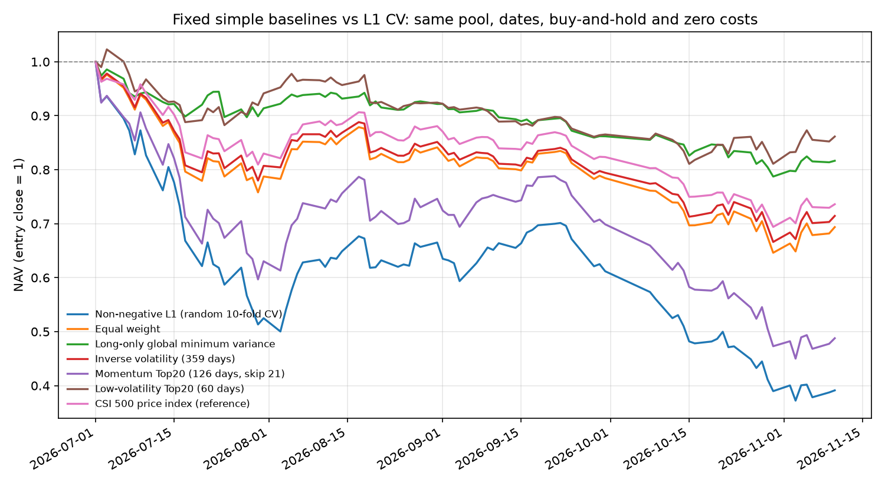

# 四个新增基准、主模型亏损归因与原论文核查

2026-11-26。本次直接接入四个基准并统一重跑，未修改冻结行情、股票池或现有l1_cv权重。旧阶段3输出保存在 `../task03/archive/2026-11-26-before-four-baselines/`。

主要结论：当前主模型的大幅亏损可以逐股、逐日对账；原论文在原2025年4月窗口的正收益也有独立行情支持。两者是不同市场样本和不同持仓的结果。恢复原附录的ridge、截断、积分及每日固定权重口径后，当前数据仍亏约60.67%，因此这些实现差异不能解释正负号改变。

## 同口径比较

所有方法使用同一100只研究股票；估计期2025-01-02至2026-06-30，共359个收益日；7月1日收盘建仓，7月2日至11月10日共88个收益日；零成本、一次建仓持有。新增参数是已有历史结果之后明确写下的回溯比较规则，不能重新称为盲测或事前登记。

| 方法 | 累计收益 | 最大回撤 | 年化波动 | 持仓数 |
|---|---:|---:|---:|---:|
| 低波动Top20，新 | −13.85% | −20.74% | 26.36% | 20 |
| GMV，新 | −18.34% | −21.27% | 20.60% | 17 |
| 波动率倒数，新 | −28.56% | −33.39% | 35.54% | 100 |
| 等权 | −30.63% | −35.39% | 38.62% | 100 |
| CVaR95 | −43.09% | −45.15% | 38.53% | 13 |
| VaR95启发式 | −43.09% | −45.15% | 38.53% | 13 |
| 动量Top20，新 | −51.22% | −55.00% | 65.75% | 20 |
| 随机十折非负L1主模型 | **−60.88%** | **−62.78%** | **67.79%** | 7 |
| 均值—方差 | −63.54% | −65.12% | 72.91% | 6 |
| 中证500价格指数，仅参照 | −26.39% | −30.60% | 32.03% | — |

完整精度见 [metrics.csv](../task03/results/metrics.csv) 和 [model_comparison.csv](results/model_comparison.csv)。VaR选中了CVaR95候选，保留 `feasible_heuristic` 状态，不表示两个问题的全局解相同。年化波动及收益均是样本换算，不是未来承诺。



四个基准规则：

- GMV：全359日样本协方差，最小化组合方差，非负且全投资，不使用收益均值目标。SLSQP目标缩放后独立核查KKT。
- 波动率倒数：全359日样本标准差的倒数归一化；零波动明确失败。
- 动量Top20：126个收益日中跳过最近21日，实际信号为2025-12-18至2026-05-29的105笔收益；复利排序前20等权。
- 低波动Top20：2026-04-01至2026-06-30的最近60笔收益，按ddof=1标准差升序取20只等权。

两个Top20均按证券代码打破并列，一次排序建仓，不冒称月度轮动。代码、参数、信号分数、排序、选股日期及全部100行权重见阶段3源码与manifest。

## 主模型为什么亏得更重

### 1. 具体持仓解释了损失

归因采用初始投资比例乘以个股整个持有期收益，资产贡献之和与公开净值对账。主模型7只股票全部亏损：

| 股票 | 初始权重 | 个股持有期收益 | 对组合收益的贡献 |
|---|---:|---:|---:|
| 宏和科技 | 26.71% | −69.92% | −18.68个百分点 |
| 德明利 | 17.02% | −69.58% | −11.84个百分点 |
| 长飞光纤 | 20.56% | −49.84% | −10.25个百分点 |
| 多氟多 | 13.16% | −56.26% | −7.40个百分点 |
| 永鼎股份 | 10.40% | −63.59% | −6.61个百分点 |
| 源杰科技 | 9.45% | −63.23% | −5.98个百分点 |
| 浙江荣泰 | 2.69% | −4.47% | −0.12个百分点 |

前三只初始权重合计64.29%，贡献约−40.77个百分点。主模型比同池等权少30.25个百分点、比价格指数少34.49个百分点。数据见 [stock_attribution.csv](results/stock_attribution.csv) 和 [active_attribution_vs_equal.csv](results/active_attribution_vs_equal.csv)。

### 2. 历史收益均值在检验期明显反转

按估计期日均收益从低到高把100只股票等分五组：

| 估计期均值分组 | 每组股票数 | 检验期个股累计收益均值 | 主模型初始资金比例 |
|---|---:|---:|---:|
| 最低20% | 20 | −13.02% | 0 |
| 第2组 | 20 | −19.04% | 0 |
| 第3组 | 20 | −20.60% | 0 |
| 第4组 | 20 | −46.38% | 13.16% |
| 最高20% | 20 | **−54.09%** | **86.84%** |

估计期与检验期个股日均收益的横截面相关为−0.7375。主模型高度暴露于估计期强势股票，这些股票在检验期跌得更重；动量Top20同期也亏51.22%。这是本窗口中收益均值外推失效的证据，不是动量或L1长期必然失效的证明。分组是事后解释，未用于调参。详见 [regime_groups.csv](results/regime_groups.csv)。

### 3. CV匹配的风险不是最终或未来风险

主模型估计期日均收益0.8587%、投入组合日波动2.7002%；原始系数日波动4.1048%。检验期实现日波动升到4.2704%，年化67.79%。随机十折匹配原始系数的验证方差；其目标既不是最大化未来收益，也不是保证归一化配置的最大回撤或未来风险。

主模型对指数的样本回归beta从估计期约1.30升至检验期约1.84，GMV检验期beta约0.49。GMV和低波动基准显著少亏，说明本窗口内风险暴露差异有实际影响。beta和风险均为事后描述，不能当作保证性预测。

### 4. 主要损失发生在7月和10月

| 月份 | 当月组合收益 | 对期初资本的净值变化 |
|---|---:|---:|
| 2026-07 | −47.51% | −47.51个百分点 |
| 2026-08 | +26.71% | +14.02个百分点 |
| 2026-09 | −8.00% | −5.32个百分点 |
| 2026-10 | −36.30% | −22.21个百分点 |
| 2026-11，截至10日 | +0.37% | +0.15个百分点 |

月收益应复利相乘，不能直接相加；最后一列净值变化可以相加并对账到−60.88%。详见 [monthly_returns.csv](results/monthly_returns.csv)。

## 原PDF为何为正，以及有没有漏掉原方法

### 原窗口的正收益得到支持，但未精确复现5.51%

[原公开PDF](../docs/RawPaper_public.pdf)原第6—10页使用沪深300股票，训练约2023年7月至2025年3月，检验2025年4月；取得280只、删除缺失后278只。原表列出14个未归一化系数，合计5.3547。

将表中系数归一化，取得14股腾讯原始及后复权行情，固定3月31日收盘作估值锚，在4月1日至4月30日的21个收益日复算：

| 收益口径 | 原文式每日固定权重 | 一次建仓持有 |
|---|---:|---:|
| 腾讯原始收盘价 | **+5.3902%** | +5.1178% |
| 腾讯后复权价格 | **+4.7395%** | +4.5214% |
| PDF披露 | **+5.51%** | 未采用 |

原始价结果与5.51%相差约11.98bp。四位系数舍入的保守区间为5.3850%至5.3953%，仍不足解释整个差异。原聚源逐日收益定义、完整精度系数和278股估计面板不在交付中，所以不能声称完整重现原优化实验。

PDF中只持有601127的基准披露+3.49%、日波动0.0313；独立原始价复算为+3.487171%、0.03133077，与披露精度一致。这是支持原窗口正收益及数据定义基本对齐的交叉证据，不能因存在少量未解释差异就认定结果无效。

原14股约43.16%配置于渝农商行、上海银行和农业银行；当前7股与原14股没有持仓重叠。股票池、估计期和检验期的变化足以产生完全不同的组合。

PDF的90.34%约等于 `(1+5.51%)^12-1`，是约一个月结果外推，不是实际赚了一整年的90%。其夏普代码把月无风险利率减去日均收益，基准部分还沿用主模型的average_return，限制了原夏普及跨模型优越性结论。

### 原附录细节补回后的同数据诊断

前一版保留了原随机十折，但未逐字采用原附录的协方差ridge和小系数截断。现在单独实现可核查的兼容性诊断，不悄悄替换当前主比较：

| 在当前同一100股与检验区间上的处理 | 累计收益 |
|---|---:|
| 当前主模型，买入持有 | −60.8802% |
| 只补系数≤0.0001清零后归一化 | −60.8802% |
| 补1e-6协方差ridge并重跑十折、截断，买入持有 | −60.8604% |
| 再改回原附录直接quad积分及每日固定权重记账 | **−60.6656%** |
| 原附录披露λ=0.4141直接放到当前数据，买入持有，仅诊断 | −63.8917% |
| 当前权重改用未复权收盘价，仅价格诊断 | −62.8347% |

ridge版本仍选出平均λ=0.222222、7持仓；直接quad与稳定Beta计算在当前数据上的差异极小。当前非零系数均高于截断阈值，截断不改变配置。全部原附录细节组合后只改变约0.215个百分点，无法解释从正收益到亏损六成。

原始价格仅用于隔离收益定义影响，缺少公司行动现金流，不能替代严格总回报。原λ移植也只是预先明确的事后诊断，未按结果挑选新的主λ。详见 [paper_compatibility.csv](results/paper_compatibility.csv)。

## 复算入口与边界

```powershell
python task03/test_eval.py
python task03/test_simple_baselines.py
python task03/run.py --output task03/results
python task03/verify.py --output task03/results
python task03/make_charts.py
python analysis/test_portfolio_diagnostics.py
python analysis/portfolio_diagnostics.py
python analysis/paper_evidence/offline_recalculate.py
```

诊断严格核对原始资产标签、净值日期及1e-12绝对误差；上游求解器允许的极小预算尾差单独记为initial_budget_residual，不隐式重归一化。`results/diagnostics.json`记录输入和分析源码哈希。原14股证据在 `paper_evidence/`，保留28份供应商原响应、URL、时间和SHA256；离线脚本先核哈希，不联网。迁移目录复算也已验证。

当前与原论文均仍受当前成分回溯、样本选择、供应商收益定义和短检验窗口限制。新增基准揭示了当前模型在该窗口的不足，不能消除数据偏差或证明某方法长期优越。后续改进应以按时间滚动的独立检验、明确作用于投资权重的风险/集中度约束及估计稳健性为依据，另开版本，不回看本窗口挑出“最好”的参数。
